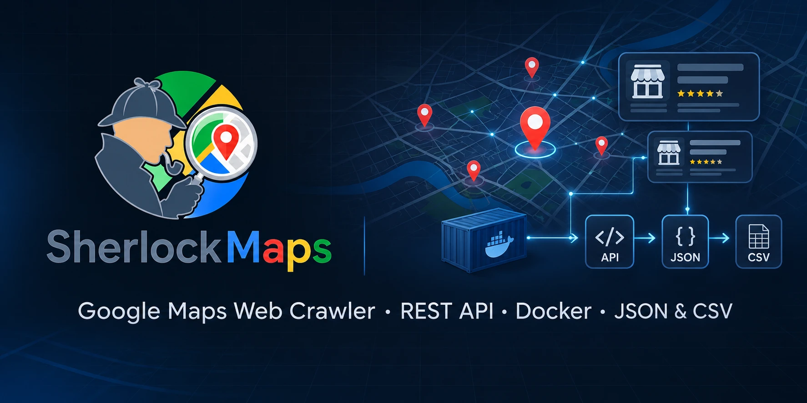
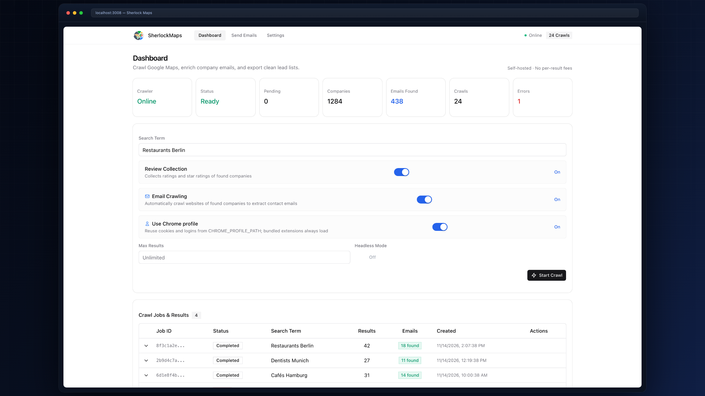
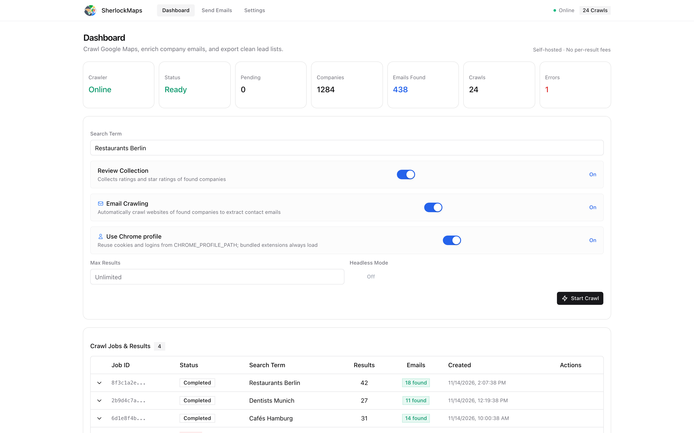
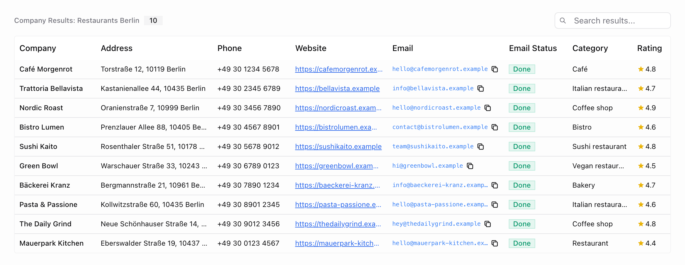
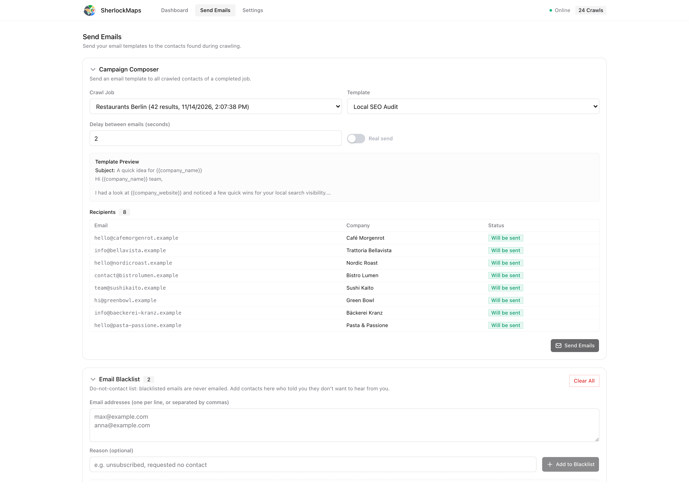
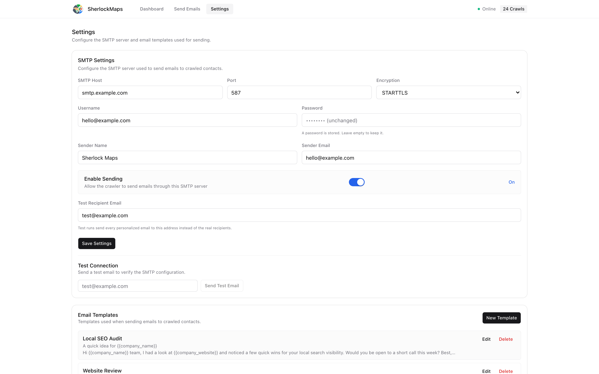
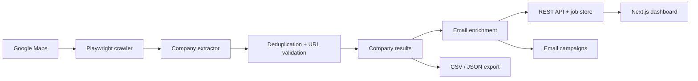

<div align="center">
  
  <h1>Sherlock Maps</h1>
  <p><strong>Turn Google Maps searches into clean, enriched lead lists — self-hosted and open source.</strong></p>
  <p>
    <a href="https://github.com/Ayyouboss0011/SherlockMaps/stargazers"></a>
    <a href="https://github.com/Ayyouboss0011/SherlockMaps/releases"></a>
    
    
    <a href="https://docs.docker.com/compose/"></a>
  </p>
</div>

<p align="center">
  <a href="docs/assets/screenshots/hero.png">
    
  </a>
</p>

Sherlock Maps is a self-hosted Google Maps crawler and lead-generation suite. It
extracts business names, categories, addresses, phone numbers, websites,
ratings, reviews, opening hours and attributes — then enriches companies with
email addresses from their websites.

Use the Next.js dashboard to start crawls, inspect results, export CSV/JSON and
run email campaigns. Use the REST API or Python library when you want to build
your own workflow.

## Why Sherlock Maps?

- **Self-hosted and open source** — your data stays on your infrastructure.
- **No per-result fees** — no paid scraper API and no credit-based pricing.
- **Full lead pipeline** — Google Maps → company data → email enrichment → export or outreach.
- **Developer-friendly** — REST API, Python library, Docker Compose and a typed Next.js UI.
- **Reproducible browser setup** — bundled cookie-consent extension plus optional local Chrome profile.

## Features

**Crawling**
- Search Google Maps with any query
- Company name, category, address, phone, website, rating, review count, Plus Code, opening hours and attributes
- Optional review extraction
- Deduplication and website URL validation
- Configurable result limits and scroll behavior

**Lead enrichment**
- Crawl company websites for email addresses
- Follow contact, imprint and about pages
- Deduplicate emails and keep source metadata
- Auto-trigger email enrichment after a map crawl

**Dashboard**
- Live crawler status and KPIs
- Job history with expandable company results
- Search, inspect and export leads
- SMTP settings, email templates and campaign history
- Do-not-contact blacklist with CSV/XLSX import

**Deployment**
- One-command Docker Compose stack
- Persistent jobs, results, SMTP data and Chrome profile
- REST API with Swagger UI
- JSON, CSV, pretty-printed and file output
- Local Python + Next.js development workflow

## Quick start

### Docker Compose (recommended)

```bash
git clone https://github.com/Ayyouboss0011/SherlockMaps.git
cd SherlockMaps
cp .env.example .env
docker compose up -d --build
```

Open:

- **Dashboard:** <http://localhost:3008>
- **API:** <http://localhost:6970>
- **Swagger UI:** <http://localhost:6970/docs>

Start a crawl from the dashboard or with the API:

```bash
curl -X POST http://localhost:6970/crawl \
  -H "Content-Type: application/json" \
  -d '{
    "prompt": "restaurants berlin",
    "auto_email_crawl": true,
    "max_results": 50
  }'
```

Check progress and export results:

```bash
curl http://localhost:6970/status
curl "http://localhost:6970/results?format=csv" -o leads.csv
```

The first build downloads Playwright and Chromium, so it can take a few minutes.
The default ports can be changed in `.env`. See the
[quick start guide](docs/quickstart.md) for local development and more commands.

## Screenshots

<p align="center">
  <a href="docs/assets/screenshots/dashboard.png"></a>
  <a href="docs/assets/screenshots/results.png"></a>
</p>
<p align="center"><em>Dashboard and enriched company results.</em></p>

<p align="center">
  <a href="docs/assets/screenshots/email-campaign.png"></a>
  <a href="docs/assets/screenshots/settings.png"></a>
</p>
<p align="center"><em>Campaign composer and SMTP/template settings.</em></p>

> Screenshots use fictional demo data. No real leads, email addresses or SMTP
> credentials are shown.

## How it works



1. **Search** — navigate to Google Maps with your search term.
2. **Scroll and extract** — load result cards and open each detail page.
3. **Clean** — deduplicate companies and validate websites.
4. **Enrich** — optionally crawl company websites for email addresses.
5. **Deliver** — inspect in the dashboard, use the API or export CSV/JSON.

More detail: [Architecture](docs/architecture.md).

## Use cases

- **Lead generation** — build targeted local-business lists for agencies and sales teams.
- **Local SEO** — audit categories, ratings, reviews and websites across a market.
- **Market research** — compare competitors, categories and opening hours by city.
- **CRM enrichment** — add websites and contact emails to an existing lead database.

## REST API & Python

The API is documented interactively at `/docs`. A typical flow:

```bash
API=http://localhost:6970

# Start a crawl
curl -X POST "$API/crawl" \
  -H "Content-Type: application/json" \
  -d '{"prompt": "cafes berlin", "auto_email_crawl": true}'

# Poll the job
curl "$API/crawl/JOB_ID"

# Get results
curl "$API/crawl/JOB_ID/results"
```

Use the crawler as a Python library:

```python
from core.crawler import run_crawler

results = run_crawler(
    prompt="restaurants berlin",
    headless=False,
    output_format="json",
)

for company in results:
    print(company.name, company.website)
```

Full endpoint reference: [REST API](docs/api.md).

## Configuration

| Variable | Default | Description |
|---|---|---|
| `API_PORT` | `6970` | Docker host port for the API |
| `UI_PORT` | `3008` | Docker host port for the dashboard |
| `OUTPUT_FORMAT` | `json` | `json`, `csv`, `pretty`, `file`, `print` |
| `HEADLESS` | `false` | Run Chromium without a window |
| `TRACK_REVIEWS` | `true` | Extract review data |
| `CHROME_PROFILE_PATH` | `core/Chrome_Profile` | Optional local Chrome profile |

See [Configuration](docs/configuration.md) for the complete list.

## Chrome profile & extensions

Your personal Chrome profile — cookies, logins and extensions — stays local and
is never committed. The crawler uses `core/Chrome_Profile` by default and also
supports `CHROME_PROFILE_PATH` and `use_persistent_profile` for API crawls.

The repository bundles **I still don't care about cookies** in
`core/extensions/`, so every user gets the same cookie-banner handling without
sharing a profile. Add your own unpacked extensions to `core/extensions/`.

- [Browser profile guide](docs/browser-profile.md)
- [Extension guide](docs/extensions.md)

## Deployment

- **Docker Compose** — [quick start](docs/quickstart.md#docker-compose-recommended)
- **Local backend + UI** — [quick start](docs/quickstart.md#local-development)
- **Reverse proxy / ports** — [configuration](docs/configuration.md)
- **Troubleshooting** — [troubleshooting](docs/troubleshooting.md)

The API has no authentication by default. Keep it on localhost or a trusted
network, or put it behind an authenticated reverse proxy.

## Roadmap

- [x] Google Maps company extraction
- [x] Email enrichment
- [x] REST API + Next.js dashboard
- [x] Docker Compose deployment
- [ ] Static demo with sample data
- [ ] n8n / Google Sheets / CRM integrations
- [ ] Additional locales
- [ ] PyPI package

Have an idea or found a bug? [Open an issue](https://github.com/Ayyouboss0011/SherlockMaps/issues).

## Contributing

Contributions are welcome. Read [CONTRIBUTING.md](CONTRIBUTING.md) for setup,
branch naming, screenshot updates and the PR checklist.

Good first issues are labeled [`good first issue`](https://github.com/Ayyouboss0011/SherlockMaps/labels/good%20first%20issue).

## License

Sherlock Maps is released under the [MIT License](LICENSE).

The bundled cookie-consent extension is GPL-3.0. See
[THIRD_PARTY_NOTICES.md](THIRD_PARTY_NOTICES.md).

## Responsible use

Sherlock Maps is intended for research and internal business use. Scraping
Google Maps may be subject to Google's Terms of Service and local law. Respect
rate limits, privacy rights and anti-spam rules. The email blacklist exists to
help you honor opt-outs.

---

<div align="center">
  <p><strong>If Sherlock Maps saves you time, a ⭐ helps other developers find it.</strong></p>
</div>
