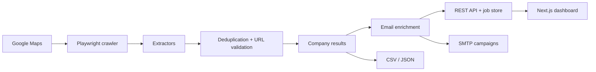

# Architecture

Sherlock Maps is split into a Python crawler/API and a Next.js dashboard. They
communicate over HTTP and can run together with Docker Compose or separately.



## Repository layout

```text
SherlockMaps/
├── core/
│   ├── api/                  FastAPI server and job queue
│   ├── browser/              Playwright lifecycle and consent handling
│   ├── extractors/           Google Maps and email extractors
│   ├── models/               CrawlerConfig, CompanyData, EmailData
│   ├── output/               JSON, CSV and pretty output
│   ├── processors/           Deduplication and URL validation
│   ├── extensions/           Bundled unpacked Chromium extensions
│   ├── Dockerfile
│   └── requirements.txt
├── LeadGenUI/
│   ├── src/app/              Dashboard, Send Emails, Settings
│   ├── src/components/       Tables, forms, campaign UI
│   ├── src/lib/              API client and shared types
│   └── Dockerfile
├── docs/                     Documentation and README assets
├── examples/                 Sample output and integration examples
├── scripts/                  Maintenance and screenshot tooling
├── public/                   App/brand assets
├── docker-compose.yml
└── README.md
```

## Crawl flow

1. **Start** — the UI or REST API creates a job in the queue.
2. **Navigate** — Playwright opens Google Maps with the search term.
3. **Consent** — the browser handles Google's consent dialog; the bundled
   cookie extension handles third-party cookie banners.
4. **Scroll** — the crawler loads result cards until the result list stops
   growing or `max_results` is reached.
5. **Extract** — each detail page is opened and the company fields, rating,
   reviews, opening hours and attributes are read.
6. **Clean** — duplicate companies are removed and website URLs are validated.
7. **Persist** — the job result is written to `core/jobs_data`.
8. **Enrich** — if enabled, the email crawler visits company websites and
   follows contact/imprint/about pages to find addresses.
9. **Deliver** — results are available in the dashboard, the REST API, or as
   JSON/CSV exports.

## Browser lifecycle

`BrowserManager` launches a persistent Chromium context. The profile path is
resolved in this order:

1. `CrawlerConfig.chrome_profile_path`
2. `CHROME_PROFILE_PATH`
3. `core/Chrome_Profile`

Extensions are discovered in `core/extensions` and loaded with
`--load-extension` and `--disable-extensions-except`. See
[Extensions](extensions.md).

API crawls use a temporary profile by default to avoid profile-lock conflicts.
Set `use_persistent_profile=true` in a crawl request to reuse the persistent
profile instead. Run one crawl at a time in that mode.

## Persistence

| Data | Local path | Docker volume |
|---|---|---|
| Jobs and results | `core/jobs_data` | `jobs_data` |
| CLI exports | `core/results` | `results` |
| SMTP/templates/history | `core/smtp_data` | `smtp_data` |
| Chrome profile | `core/Chrome_Profile` | `chrome_profile` |

The Chrome profile is intentionally **not** part of Git. It contains cookies,
login data and session storage.

## Frontend

The Next.js app is a client-side dashboard with three routes:

- `/` — live stats, crawl form, job/results table
- `/send-email` — campaign composer, blacklist and send history
- `/settings` — SMTP configuration and email templates

In Docker, the browser talks to the API through the host port (`6970` by
default). Inside the container, the Next.js server proxy can reach the crawler
at `http://crawler:8000`.

## Design choices

- **Persistent job store** — jobs survive restarts and container rebuilds.
- **Process-based crawls** — Playwright sync API runs in a worker process to
  avoid asyncio conflicts.
- **Reproducible browser extensions** — the cookie extension is bundled, while
  personal browser state stays local.
- **No database required** — JSON files keep setup simple; the API can be
  replaced by a database-backed store later.
- **Two deployment modes** — Docker Compose for the full stack, or local
  Python/Node processes for development.
